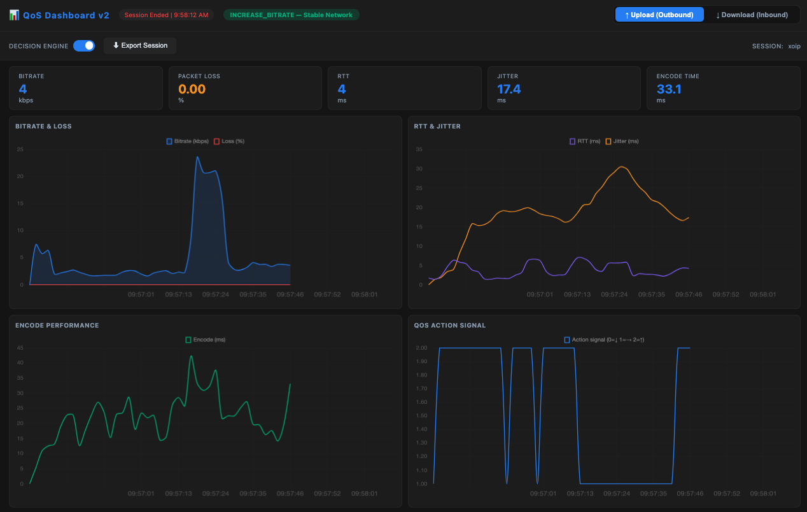

🚀 Stop bundling 50MB SDKs just to add video calling to your web app.

What if WebRTC was as simple as:
```html
<xoip-call id="call" src="xoip://call/nostr/..." />
<xoip-qos for="call" monitor-inbound decision-engine auto-start></xoip-qos>
```

Meet **xoip-call** ⚡ — an open-source, production-ready Web Component suite that packs a complete WebRTC engine, swappable signaling, and intelligent QoS monitoring into native Web Standards.

Zero bloated dependencies. Zero vendor lock-in. 

Here is why frontend architects and privacy-first teams are loving it:

🌐 **Zero-Dependencies Core**
Built 100% on native standards: RTCPeerConnection, Web Crypto API, Web Workers, and WebSockets. No framework lock-in (React, Vue, Svelte, or vanilla HTML).

🤝 **W3C Perfect Negotiation**
Eliminates glare, collision errors, and SDP offer/answer race conditions forever via polite/impolite peer roles and sequential rollback.

⚡ **Serverless P2P with Nostr & Pluggable Signaling**
Want 100% serverless, censorship-resistant signaling? It talks directly to decentralized Nostr relays via ephemeral events (Kind 25050) with automated relay health discovery. Need cloud or self-hosted? Swap to Firebase Firestore or a 40-line Node.js WebSocket adapter in one line.

🔒 **Dual-Tier End-to-End Encryption (E2EE)**
1. Signaling E2EE: AES-256-GCM encrypted signals derived via HKDF-SHA-256.
2. Media E2EE: Hardware-accelerated frame encryption inside a dedicated Web Worker via WebRTC Insertable Streams.

🧠 **Intelligent QoS Monitoring & Self-Healing with `<xoip-qos>`**
Network jitter and packet drops? Just drop `<xoip-qos for="call">` right next to your call element:
- **Zero-Touch Declarative Binding**: Links to `<xoip-call>` via `for="id"` with resilient auto-discovery and zero code changes to your UI.
- **Off-Main-Thread Architecture**: 4 isolated Web Workers (`qos`, `ai`, `ice`, `history`) communicating over a typed `WorkerEventBus` (BroadcastChannel) — keeping your UI buttery smooth at 60 FPS.
- **Bidirectional Telemetry**: Real-time sliding-window analysis for both Outbound (upload) and Inbound (download) audio & video streams (RTT, packet loss, jitter, decode time, freeze count).
- **Self-Healing Adaptive Bitrate & Remote Control**: Local AI decision engine dynamically tunes encoder bitrate and resolution down/up. Under heavy inbound congestion, it automatically dispatches low-latency commands over WebRTC DataChannel asking the remote peer to reduce their bitrate.
- **Integrated Live Analytics Dashboard**: Launch a high-precision live telemetry cockpit in a standalone window or new tab with one click (`qos.openDashboard()`), powered by indexed session history.



🔗 **The `xoip://` Connection Protocol**
Share a single link:
`xoip://call/nostr/<TOKEN>?room=123#key=<ROOM_KEY>`
Thanks to RFC 3986 fragment isolation, the 256-bit encryption key never leaves the client's memory or touches any server.

🎨 **Deep UI Customization**
- Style via CSS Custom Properties (`--xoip-*`)
- Pinpoint targeting with Shadow Parts: `xoip-call::part(controls-bar)`
- Or slap on the `headless` attribute and build your own bespoke messenger UI from scratch using the reactive JS API.

Whether you're building a private peer-to-peer messenger, an internal enterprise telemedicine tool, or remote pair-programming video feeds — you own your stack.

👉 Check out the source code, interactive demos, and User Guide: [Link to your GitHub / Repo]

💬 What’s your biggest headache when implementing WebRTC today: signaling infrastructure, QoS & adaptive bitrate, or vendor pricing? Let's discuss in the comments!

#WebRTC #JavaScript #OpenSource #WebDevelopment #Frontend #WebComponents #QoS #QualityOfService #Privacy #Decentralization #Nostr #P2P
